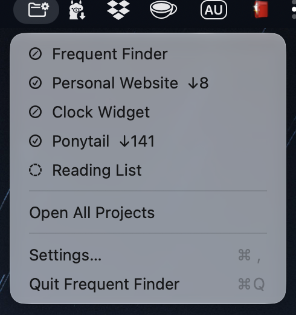
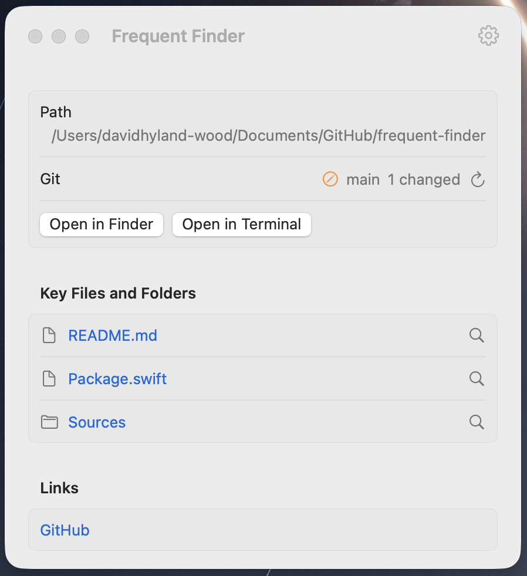
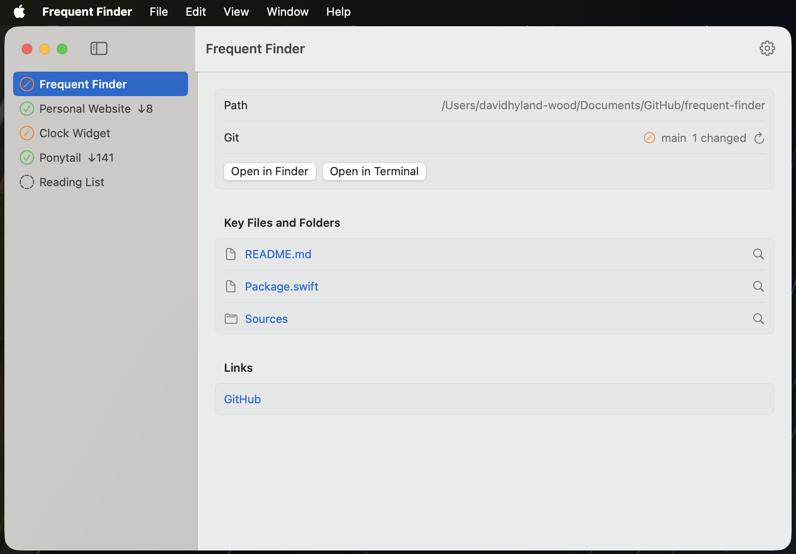

# frequent-finder

A macOS utility to keep track of current projects and their files. It lives in your menu bar and optionally opens windows.

Macs are much better at giving you the tools to manage information overload, or maybe I am just more familiar with the options. However, for years I have wanted a better way to cut through the noise of many concurrent projects, with many files, that are scattered across many file trees, repos, websites, etc. I have wanted a way to easily track my current projects including:

- Seeing git status at a glance
- A one-click place to open a Finder or terminal in the project directory
- A single project-context place to list relevant files, folders, repos, URLs, etc
- A CLI to drive the GUI, including marking projects active or inactive.
- Mark a project as "active" or "inactive". Inactive projects are hidden.

## How to use the GUI

- Click the menu bar icon to see your projects, each with a git status symbol
  (✓ clean, ✎ dirty, dashed circle = not a git repo), plus ↑N commits to push and
  ↓N to pull (as of the last `git fetch`).
- Click a project to open its window: open the folder in Finder, open Terminal or
  iTerm there, see the branch, open key files and links.
- A project can list git repositories (for a folder holding many repos). Each shows its own
  status; the menu sums them up. Settings → Find Repositories adds all repos up to 3 levels down.
- Open All Projects (in the menu) shows a resizable window with every project on the left and
  the selected one's details on the right. It shows a Dock icon while open, remembers its size,
  and reopens at launch if it was open when the app quit.
- Settings… (⌘,) edits projects, the terminal choice, Show in menu bar, and Open at login.
  If you hide the menu bar icon, open the app again from Finder or Spotlight to bring it back.
- Mark a project inactive (Settings → Active, or `ff deactivate`) to hide it from the menu and
  All Projects. Settings lists inactive projects in a collapsible group so you can turn them back on.
- The `ff` command does the same from the command line.

| Menu | Project window |
| --- | --- |
|  |  |



## Build and install

Needs macOS 15 or later and Xcode (or the Swift toolchain).

```bash
scripts/make-app.sh            # builds build/FrequentFinder.app and installs ~/.local/bin/ff
scripts/make-app.sh --install  # also copies the app to /Applications
```

Make sure `~/.local/bin` is on your `PATH`.

## Command line

```
$ ff help
usage:
  ff list [--json]                      show all projects
  ff add <path> [--name "Name"]         add a project (name defaults to the folder name)
  ff add --name "Name"                  add a project with no folder (only repos, files, links)
  ff remove <name>
  ff rename <name> <new-name>
  ff activate <name>                    show the project in the menu again (the default)
  ff deactivate <name>                  hide the project from the menu
  ff set-path <name> <path>
  ff set-path <name> --none             remove the project's folder
  ff file add <name> <file>...          add key files or folders (any location)
  ff file remove <name> <file>...
  ff repo add <name> <path>...          add git repositories with their own status
  ff repo remove <name> <path>...
  ff repo find <name>                   add every repository up to 3 levels below the project
  ff url add <name> <url> [--label "Label"]
  ff url remove <name> <url>
  ff terminal [terminal|iterm]          show or set the terminal app
  ff help

Config file: ~/.config/frequent-finder/projects.json (override with FF_CONFIG)
```

Project names are not case-sensitive. Errors exit with code 1, usage errors with code 2.

## Config file

`~/.config/frequent-finder/projects.json` (set `FF_CONFIG` to use another file).
The app reloads it when it changes.

```json
{
  "projects" : [
    {
      "keyFiles" : [ "README.md" ],
      "name" : "Frequent Finder",
      "path" : "/Users/me/code/frequent-finder",
      "repos" : [ ],
      "urls" : [ { "label" : "GitHub", "url" : "https://github.com/me/frequent-finder" } ]
    }
  ],
  "terminal" : "iterm"
}
```

`keyFiles` are files or folders: relative to `path` when inside the project, else absolute (shown as `(external)/<name>`). `repos` are stored the same way. `path` may be left out for a project with no folder
(Settings → Path → Clear); then every item is an absolute path. `label` is optional. `active` is `true` when left out; `false` hides the project from the menu and All Projects. `terminal` is `terminal` or `iterm`.

## Development

```bash
swift test
swift scripts/make-icon.swift   # redraws Resources/AppIcon.icns
```

